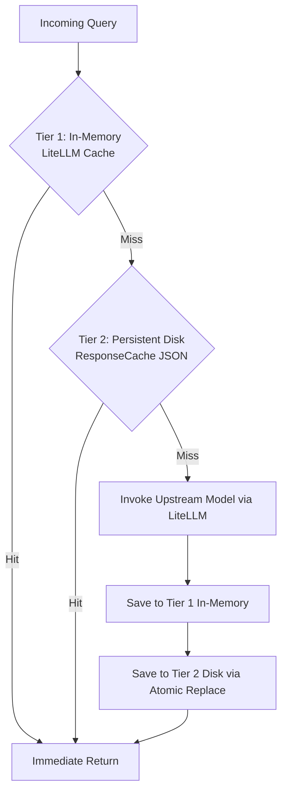
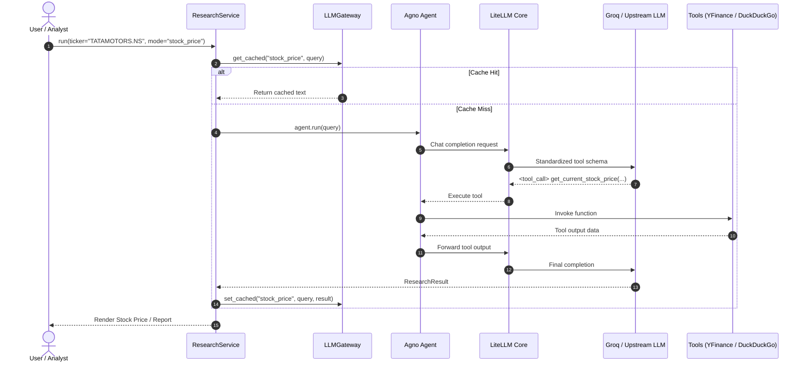

# Investment Research

An AI-powered equity research and financial market analysis platform built with **Agno**, **LiteLLM Gateway**, **Groq**, **Yahoo Finance**, **DuckDuckGo**, and **Streamlit**.

The platform provides real-time stock quotes, comprehensive source-backed equity research reports, zero-LLM-cost multilingual translation (English / Hindi), centralized gateway-level response caching, gateway tool call budgeting, structured JSON observability, and quantitative technical analysis calculations.

---

## Table of Contents

- [Overview](#overview)
- [Functional Features](#functional-features)
  - [1. Real-Time Stock Price Lookup](#1-real-time-stock-price-lookup)
  - [2. Comprehensive Equity Research Reports](#2-comprehensive-equity-research-reports)
  - [3. Multilingual Translation (English / Hindi)](#3-multilingual-translation-english--hindi)
  - [4. Interactive Streamlit Web Dashboard](#4-interactive-streamlit-web-dashboard)
  - [5. Standalone Command-Line Tools](#5-standalone-command-line-tools)
  - [6. Quantitative Technical Indicators](#6-quantitative-technical-indicators)
- [System Architecture](#system-architecture)
  - [Architecture Flowchart](#architecture-flowchart)
  - [Directory Structure](#directory-structure)
  - [Technology Stack](#technology-stack)
- [Technical Details & Deep Dive](#technical-details--deep-dive)
  - [LiteLLM Gateway Architecture & Governance](#litellm-gateway-architecture--governance)
    - [Centralized Model Routing & Multi-Provider Abstraction](#centralized-model-routing--multi-provider-abstraction)
    - [Gateway Tool Call Budgeting & Runaway Protection](#gateway-tool-call-budgeting--runaway-protection)
    - [Gateway Multi-Tier Caching (LiteLLM In-Memory & Atomic Disk)](#gateway-multi-tier-caching-litellm-in-memory--atomic-disk)
    - [Tool Calling Architecture & Safe Aliasing](#tool-calling-architecture--safe-aliasing)
    - [Anti-Blocking Session & Regional Ticker Support](#anti-blocking-session--regional-ticker-support)
    - [Automated Gateway Retries & Resilience](#automated-gateway-retries--resilience)
  - [Translation Pipeline & Cost Optimization](#translation-pipeline--cost-optimization)
  - [Structured Observability & JSON-Lines Logging](#structured-observability--json-lines-logging)
- [Configuration Reference](#configuration-reference)
- [Installation & Setup](#installation--setup)
  - [Prerequisites](#prerequisites)
  - [Option A: Setup with `uv` (Recommended)](#option-a-setup-with-uv-recommended)
  - [Option B: Setup with standard `pip`](#option-b-setup-with-standard-pip)
  - [Environment Variables (.env)](#environment-variables-env)
  - [Streamlit Cloud Secrets](#streamlit-cloud-secrets)
- [Usage Guide](#usage-guide)
  - [Running the Streamlit Web Dashboard](#running-the-streamlit-web-dashboard)
  - [Running the Single-Query Stock Price CLI](#running-the-single-query-stock-price-cli)
  - [Running the Interactive Detailed Research CLI](#running-the-interactive-detailed-research-cli)
- [Testing & Quality Assurance](#testing--quality-assurance)
- [Disclaimer](#disclaimer)

---

## Overview

Investment Research bridges large language models and real-time financial market data to automate company research. It provides two core execution workflows:
1. **Stock Price Check**: A fast, low-token financial lookup providing the latest stock price, currency, and timestamp.
2. **Detailed Equity Research**: An autonomous multi-agent team that gathers live market fundamentals from Yahoo Finance and recent web news from DuckDuckGo, synthesizing them into a structured report with tables, risks, and source citations.

---

## Functional Features

### 1. Real-Time Stock Price Lookup
- Targeted prompt instructions restrict LLM responses strictly to price, currency, and last updated timestamp (no conversational filler).
- Token bounded with `STOCK_PRICE_MAX_TOKENS` (default: 200 tokens) for low latency and minimal inference cost.
- Resilient lookup: uses `YFinanceTools` as the primary market provider and automatically fails over to `DuckDuckGoTools` web search if financial API calls fail.

### 2. Comprehensive Equity Research Reports
- Multi-agent coordination: A lead coordinator orchestrates specialized web and financial agents.
- Generates structured equity reports covering:
  - **Executive Summary**: Core business activities and market position.
  - **Key Metrics**: P/E ratio, market cap, 52-week ranges, income statement highlights, and analyst recommendations.
  - **Market News & Catalysts**: Recent developments gathered from live web search.
  - **Risks & Uncertainties**: Operational, competitive, and macroeconomic headwinds.
  - **Source Citations**: Explicit links and attributions for all external data.

### 3. Multilingual Translation (English / Hindi)
- Instant translation of detailed equity research reports into **Hindi** (`hi`) directly within the Streamlit UI.
- **Zero Extra LLM Tokens**: Powered client-side by `deep-translator` (`GoogleTranslator`) rather than costly secondary LLM generation.
- **Session-State Caching**: Translations are cached in UI session state `(ticker, mode, "Hindi")` so toggling between English and Hindi is instantaneous.
- **Export in Target Language**: Downloaded Markdown reports reflect the currently selected language.

### 4. Interactive Streamlit Web Dashboard
- Modern web dashboard built with Streamlit (`streamlit_app.py`).
- Pre-populated with default tickers (e.g., `BHEL`, with quick examples like `HMA`, `RPOWER`, `JKTYRE`, `AAPL`).
- Dual action buttons: **Get stock price** and **Generate detailed research**.
- Live expandable progress status (`st.status`).
- One-click report download as Markdown (`<ticker>-<mode>-<language>.md`).
- Integrated sidebar displaying active Groq model, cache status, and workflow guide.

### 5. Standalone Command-Line Tools
- `main-stockprice-only.py`: Single-shot CLI for rapid price checks with ticker input validation and graceful exit on `Ctrl+C` or EOF.
- `main-with-details.py`: Interactive REPL research shell supporting consecutive company queries, cache lookups, and clean `exit` commands.

### 6. Quantitative Technical Indicators
- Module in `src/investment_research/analysis/technicals.py` providing pure-Python calculations:
  - **Simple Moving Average (`moving_average`)**: Computes sliding window averages over price series.
  - **Daily Returns (`daily_returns`)**: Calculates period-over-period percentage price changes.
  - **Maximum Drawdown (`maximum_drawdown`)**: Computes peak-to-trough drop over historical price sequences.

### 7. Real-Time LLM Telemetry Dashboard
- Integrated directly into the Streamlit sidebar under the **"Research Setup"** panel:
  - **💾 Cache Details**: Real-time indication of cache `HIT` vs `MISS`, lookup latency in milliseconds, SHA256 cache key hash, storage tier (`Tier-2 Atomic Disk Cache`), and estimated latency/tokens saved.
  - **🪙 Token Usage**: Micro-breakdown of Prompt, Output, and Total tokens with estimated API costs (and visual indicator when 0 tokens are consumed on a cache hit).
  - **🔧 Called Tools & Durations**: Complete inventory of every tool invoked (e.g., `get_current_stock_price`, `duckduckgo_search`) with per-tool execution timings in milliseconds, status icons, and input arguments.
  - **🔄 Data Flow Steps**: Sequential step-by-step audit trace from Ticker Normalization to Gateway Cache Check, Tool Execution, LLM Synthesis, and Cache Commit.

---

## System Architecture

### Architecture Flowchart

```mermaid
flowchart TD
    User([User / Analyst]) --> UI{Interface}
    UI -->|Web Browser| ST[Streamlit App\nstreamlit_app.py]
    UI -->|CLI Single Query| CLI1[Stock Price CLI\nmain-stockprice-only.py]
    UI -->|CLI Interactive| CLI2[Detailed Research CLI\nmain-with-details.py]

    ST --> Service[ResearchService\nresearch_service.py]

    subgraph GW["LiteLLM Gateway Layer (src/investment_research/gateway.py)"]
        GWRouter[LLMGateway Controller]
        GWCacheCheck{Gateway Cache\nHit or Miss?}
        GWPolicy[Policy Engine\nTool Call Budget (Max 5)\nRetries & Aliasing]
        LiteSDK[LiteLLM SDK & Router]
        DiskCache[(Atomic Disk Cache\ncache/responses.json)]
        MemCache[(LiteLLM Local Cache)]

        GWRouter --> GWCacheCheck
        GWCacheCheck -->|Cache Hit| ReturnCached[Return Cached Result]
        GWCacheCheck -->|Cache Miss| GWPolicy
        GWPolicy --> LiteSDK
        GWCacheCheck -.-> DiskCache
        GWCacheCheck -.-> MemCache
    end

    Service --> GWRouter
    CLI1 --> GWRouter
    CLI2 --> GWRouter

    LiteSDK -->|Unified Route| UpstreamLLM[Upstream LLM Providers\nGroq / OpenAI / Anthropic / Ollama]
    GWPolicy --> Agents[Agno Multi-Agent Team]

    Agents -->|Price Quotes| ToolsYF[YFinanceTools]
    Agents -->|Live News / Web| ToolsDDG[DuckDuckGoTools]

    Agents --> ObsLogger[(JSON-Lines Logger\nlogs/app.log)]

    ST --> LangCheck{Selected Language}
    LangCheck -->|English| Render[Render Markdown Report]
    LangCheck -->|Hindi| Trans[Translator Layer\ndeep-translator / API Fallback]
    Trans --> Render
    Render --> Download[Download .md Report]
```

### Directory Structure

```text
Investment-Research/
├── .env.example                       # Template for environment variables
├── pyproject.toml                     # Project metadata, dependencies, and build configuration
├── requirements.txt                   # Standard pip dependency manifest
├── README.md                          # Complete functional and technical documentation
├── streamlit_app.py                   # Streamlit web dashboard entrypoint
├── main-stockprice-only.py            # Standalone CLI for stock price lookup
├── main-with-details.py               # Standalone interactive CLI for detailed research
├── logs/                              # Runtime log directory
│   └── app.log                        # Structured JSON-lines application logs
├── cache/                             # Local cache directory
│   └── responses.json                 # SHA-256 keyed JSON response cache
├── src/
│   └── investment_research/           # Core library package
│       ├── __init__.py                # Package initialization & CLI entry point
│       ├── settings.py                # Centralized immutable configuration (Settings)
│       ├── gateway.py                 # LiteLLM Gateway (routing, tool limits, multi-tier cache)
│       ├── research_service.py        # High-level orchestration service (ResearchService)
│       ├── telemetry_ui.py            # Streamlit LLM Telemetry sidebar renderer
│       ├── cache.py                   # Atomic JSON caching engine (ResponseCache)
│       ├── observability.py           # Structured JSON-lines logger & metric extractor
│       ├── translator.py              # Zero-LLM text chunking & Hindi translation pipeline
│       ├── analysis/
│       │   └── technicals.py          # Quantitative analysis (SMA, returns, drawdown)
│       ├── data/
│       │   └── market_data.py         # Ticker validation and normalization
│       └── reports/
│           └── report_format.py       # Markdown report structuring and required sections
└── tests/                             # Deterministic unit and integration test suite
    ├── conftest.py                    # Pytest environment setup (offline model cost maps)
    ├── test_telemetry.py              # LLM Telemetry UI component rendering tests
    ├── test_gateway.py                # LiteLLM Gateway model formatting, tool limits, and caching
    ├── test_cache.py                  # Cache hits, misses, TTL, and corruption recovery
    ├── test_market_data.py            # Ticker normalization and validation tests
    ├── test_report_format.py          # Report schema validation tests
    ├── test_research_service.py       # Agent tool call budget enforcement tests
    ├── test_settings.py               # Configuration defaults and immutability tests
    ├── test_streamlit_app.py          # Streamlit UI AppTest and translation state tests
    ├── test_technicals.py             # Math tests for SMA, returns, and drawdown
    └── test_translator.py            # Chunking and translation fallback tests
```

### Technology Stack

| Component | Technology | Version | Purpose |
| --- | --- | --- | --- |
| **Language** | Python | `>=3.13` | Modern Python runtime |
| **Package Management** | `uv` / `pip` | Latest | High-speed dependency resolver and virtual environment manager |
| **LLM Gateway** | `litellm` | `>=1.109.1` | Centralized LLM gateway, model routing, native caching, and tool policies |
| **Agent Framework** | `agno` | `>=3.0.10` | Autonomous multi-agent coordination, tools, and instructions |
| **LLM Provider** | `groq` / `langchain-groq` | `<1.0.0` | Ultra-low latency inference for Llama / Qwen models routed via LiteLLM |
| **Web UI** | `streamlit` | `>=1.57.0` | Interactive web dashboard and component rendering |
| **Financial Data** | `yfinance` | `>=1.7.0` | Market quotes, financials, analyst ratings, and news |
| **Live Web Search** | `ddgs` (DuckDuckGo) | `>=9.16.0` | Real-time web intelligence and source citations |
| **Translation Engine** | `deep-translator` | `>=1.11.4` | Client-side zero-token translation to Hindi |
| **Configuration** | `pydantic` & `python-dotenv` | `>=2.13.5` | Strict schema validation and `.env` loading |
| **Testing** | `pytest` | `>=8.0.0` | Deterministic unit and UI testing |

---

## Technical Details & Deep Dive

### LiteLLM Gateway Architecture & Governance

The platform implements an **LLM Gateway** pattern powered by **LiteLLM** (`src/investment_research/gateway.py`). Rather than coupling application logic directly to proprietary provider APIs (e.g. raw Groq SDK), all model routing, tool call constraints, and caching are governed by the gateway middleware.

```mermaid
flowchart LR
    subgraph App["Application Layer"]
        Streamlit[Streamlit Dashboard]
        CLI_Stock[Stock Price CLI]
        CLI_Details[Detailed Research CLI]
    end

    subgraph GW["LiteLLM Gateway Control Plane (gateway.py)"]
        Router[Model Router & Formatter]
        CacheManager[Gateway Cache Manager]
        PolicyEngine[Tool Policy & Budgeting Engine]
        LiteSDK[LiteLLM SDK Core]
    end

    subgraph Providers["Upstream LLM Providers"]
        Groq[Groq Cloud API\nLlama 3.3 / Qwen]
        OpenAI[OpenAI / Azure]
        Anthropic[Anthropic Claude]
        Local[Local / Ollama]
    end

    App -->|Requests| Router
    Router --> CacheManager
    CacheManager --> PolicyEngine
    PolicyEngine --> LiteSDK
    LiteSDK --> Providers
```



#### Centralized Model Routing & Multi-Provider Abstraction

- **Universal Model Identifiers**: The gateway normalizes model names using the LiteLLM standard syntax (`<provider>/<model_name>`):
  - `groq/llama-3.3-70b-versatile`
  - `groq/qwen/qwen3.8-27b`
  - `openai/gpt-4o`
  - `anthropic/claude-3-5-sonnet`
- **Dynamic Normalization (`format_model_id`)**: If an unqualified model name (e.g. `llama-3.3-70b-versatile`) is configured in `.env`, the gateway automatically formats it as `groq/llama-3.3-70b-versatile`. Switching providers requires updating only the model string without changing code.
- **Parameter Dropping (`litellm.drop_params = True`)**: Ensures that parameters specific to one provider do not cause crashes when migrating requests to alternative providers.

#### Gateway Tool Call Budgeting & Runaway Protection

Tool execution guardrails are now enforced centrally at the gateway level rather than individually in agent scripts:
- **Max Tool Call Limit (`AGENT_TOOL_CALL_LIMIT`)**: The gateway injects `tool_call_limit=self.settings.agent_tool_call_limit` (default: `5`) into every agent via `gateway.create_agent()`.
- **Token Budgeting**: Single price checks are capped at `STOCK_PRICE_MAX_TOKENS` (default: `200`) to guarantee fast, sub-second responses and predictable token usage.
- **Runaway Loop Mitigation**: If an agent attempts more than the allocated budget of tool calls, the gateway halts execution, preventing infinite loops and billing spikes.

#### Gateway Multi-Tier Caching (LiteLLM In-Memory & Atomic Disk)

Caching has been moved into the LLM Gateway layer, providing a 3-tier caching hierarchy:



1. **Tier 1: LiteLLM Native In-Memory Cache**:
   Configured in `gateway.py` with `litellm.cache = Cache(type="local", ttl=settings.cache_ttl_seconds)`. Fast RAM cache that skips completion requests for identical prompts during the current process lifetime.
2. **Tier 2: Persistent Atomic Disk Cache (`ResponseCache`)**:
   Managed by the gateway in `cache/responses.json`. Generates SHA-256 digests based on `namespace:model:query`:
   $$\text{Key} = \text{SHA256}(\text{"namespace:model:query"})$$
   Uses `tempfile.NamedTemporaryFile` + `os.replace` for atomic file writes to prevent JSON corruption during concurrent access or unexpected terminations.
3. **Tier 3: Streamlit Session State**:
   Client-side in-memory cache in `streamlit_app.py` storing the active `ResearchResult` and translated Hindi reports (`(ticker, mode, "Hindi")`) for instantaneous language toggling without hitting disk or translation APIs.

#### Tool Calling Architecture & Safe Aliasing



- **Registered Tools**:
  - `YFinanceTools`: `get_current_stock_price`, `get_company_news`, `get_analyst_recommendations`, `get_income_statements`.
  - `DuckDuckGoTools`: `web_search` and `search_news` (isolated to detailed research to avoid model confusion during price checks).
  - `searchNews`: Registered fallback tool function in `tools=[...]` to catch model camelCase hallucinations without triggering Groq schema validation errors.
- **Hierarchical Delegation**: The coordinator agent receives sub-agents (`web_agent` and `finance_agent`) in its `tools` list, orchestrating fundamental financial checks and qualitative web intelligence into a unified report.

#### Anti-Blocking Session & Regional Ticker Support

- **Browser Emulation**: Attaches a custom `requests.Session` with desktop Chrome headers (`User-Agent: Mozilla/5.0...`, `Accept`, `Accept-Language`) to `YFinanceTools` to prevent HTTP 403 Forbidden blocks.
- **Regional Ticker Resolution**: Automatically instructs the agent to append `.NS` (NSE) or `.BO` (BSE) for Indian tickers (e.g., `BHEL`, `TATAMOTORS`, `RPOWER`, `JKTYRE`).
- **Failover Strategy**: If Yahoo Finance is blocked or unavailable, the agent seamlessly falls back to DuckDuckGo search.

#### Automated Gateway Retries & Resilience

- **Gateway-Level Retries**: `litellm.num_retries = 2` automatically retries upstream provider failures (e.g. HTTP 429 rate limits, 502/503 timeouts).
- **Agent-Level Retries**: `retries=2, delay_between_retries=1` enforced on Agno `Agent` by `gateway.create_agent()`.
- **Service Retry Loop**: `ResearchService.run` catches any transient tool validation errors and re-executes automatically in the background.

### Translation Pipeline & Cost Optimization
The translation layer in `src/investment_research/translator.py` translates reports into Hindi without incurring LLM inference costs:
- **Intelligent Chunking (`_split_into_chunks`)**: Translation APIs enforce input length limits (~5,000 characters). The module splits long markdown text at paragraph boundaries (`\n\n`), line breaks (`\n`), or words, with a safe chunk threshold of 3,500 characters.
- **Two-Tier Resilient Translation**:
  1. Primary: Uses `GoogleTranslator(source="auto", target="hi")`.
  2. Fallback: If `GoogleTranslator` encounters rate limits (`TooManyRequests`, `RequestError`), it automatically shifts to direct client HTTP requests (`https://translate.googleapis.com/translate_a/single`) with Android translate client headers.
- **English No-Op**: If the target language is `"English"` or `"en"`, the text returns immediately without network calls.

### Structured Observability & JSON-Lines Logging
Structured observability is built into every request via `src/investment_research/observability.py`:
- **Dual Outputs**: Logs are streamed in real time to standard console output and appended to `logs/app.log`.
- **JSON-Lines Format**: Every log line is formatted as a single valid JSON record using `JsonFormatter`:
  ```json
  {
    "timestamp": "2026-11-13T11:15:30+0530",
    "level": "INFO",
    "logger": "investment_research",
    "event": "research_completed",
    "application": "streamlit",
    "ticker": "BHEL",
    "mode": "detailed_research",
    "duration_ms": 2840.12,
    "response_metrics": {"input_tokens": 420, "output_tokens": 680}
  }
  ```
- **Tracked Lifecycle Events**:
  - `research_started`: Records ticker, query, model, and configured tools.
  - `research_completed`: Records latency (`duration_ms`) and token metrics.
  - `research_cache_hit`: Emitted when results are served from cache.
  - `research_failed`: Records duration, exception type, and full traceback.
  - `invalid_ticker`: Emitted when ticker validation fails.
  - `session_ended`: Emitted upon user exit or stream closure.

---

## Configuration Reference

Application settings are centralized in `src/investment_research/settings.py` as an immutable frozen dataclass (`Settings`) and can be configured through `.env` or system environment variables:

| Variable | Default Value | Description |
| --- | --- | --- |
| `GROQ_API_KEY` | *None* (Required) | Groq API authentication key. |
| `GROQ_MODEL` | `qwen/qwen3.8-27b` *(code)* / `llama-3.3-70b-versatile` *(.env.example)* | Groq model ID used for inference. |
| `STOCK_PRICE_MAX_TOKENS` | `200` | Token limit for single stock-price lookups. |
| `AGENT_TOOL_CALL_LIMIT` | `5` | Maximum allowed tool calls per agent run. |
| `DEFAULT_TICKER` | `BHEL` | Default ticker populated in the web dashboard. |
| `APP_NAME` | `Market Research` | Application brand name used in logs and UI title. |
| `LOG_LEVEL` | `INFO` | Logging verbosity (`DEBUG`, `INFO`, `WARNING`, `ERROR`). |
| `LOG_FILE` | `logs/app.log` | Destination path for structured JSON-lines log records. |
| `CACHE_ENABLED` | `false` | Set to `true`, `1`, `yes`, or `on` to enable response caching. |
| `CACHE_FILE` | `cache/responses.json` | Path to the local JSON response cache file. |
| `CACHE_TTL_SECONDS` | `900` | Lifetime of cached entries in seconds (900s = 15 minutes). Set to `0` to disable. |

> [!WARNING]
> Never commit your `.env` file or API keys to version control. Use `.env.example` as a safe template.

---

## Installation & Setup

### Prerequisites
- **Python**: Version `3.13` or later.
- **Groq API Key**: A valid API key obtained from [Groq Console](https://console.groq.com/).

### Option A: Setup with `uv` (Recommended)

`uv` is an extremely fast Python package and environment manager.

1. **Clone the repository and enter the directory**:
   ```bash
   git clone <repo-url>
   cd Investment-Research
   ```

2. **Sync the virtual environment and install dependencies**:
   ```powershell
   uv sync
   ```

3. **Create and configure your `.env` file**:
   ```powershell
   Copy-Item .env.example .env
   ```

4. **Add your Groq API key to `.env`**:
   ```dotenv
   GROQ_API_KEY=gsk_your_actual_groq_api_key_here
   ```

### Option B: Setup with standard `pip`

If you prefer standard Python tools:

1. **Create and activate a virtual environment**:
   ```powershell
   python -m venv .venv
   .venv\Scripts\Activate.ps1
   ```
   *(On macOS / Linux: `source .venv/bin/activate`)*

2. **Install dependencies**:
   ```powershell
   pip install -r requirements.txt
   ```

3. **Configure environment variables**:
   ```powershell
   Copy-Item .env.example .env
   # Edit .env and supply your GROQ_API_KEY
   ```

### Environment Variables (.env)

A typical `.env` setup:
```dotenv
GROQ_API_KEY=your-groq-api-key-here
GROQ_MODEL=llama-3.3-70b-versatile
STOCK_PRICE_MAX_TOKENS=200
AGENT_TOOL_CALL_LIMIT=5
DEFAULT_TICKER=BHEL
APP_NAME=Market Research
LOG_LEVEL=INFO
LOG_FILE=logs/app.log
CACHE_ENABLED=false
CACHE_FILE=cache/responses.json
CACHE_TTL_SECONDS=900
```

### Streamlit Cloud Secrets

When deploying to [Streamlit Community Cloud](https://share.streamlit.io), add your variables in **App Settings > Secrets**:
```toml
GROQ_API_KEY = "gsk_your_groq_api_key"
GROQ_MODEL = "llama-3.3-70b-versatile"
CACHE_ENABLED = "false"
```
`streamlit_app.py` automatically synchronizes all entries in `st.secrets` into `os.environ` upon startup.

---

## Usage Guide

### Running the Streamlit Web Dashboard

Launch the interactive web user interface:

```powershell
# Using uv:
uv run streamlit run streamlit_app.py

# Using standard virtualenv:
streamlit run streamlit_app.py
```

Open your browser at `http://localhost:8501`.

**Dashboard Features**:
- **Ticker Input**: Enter any stock symbol (e.g. `AAPL`, `TSLA`, `BHEL`, `RELIANCE`).
- **Get stock price**: Fetches real-time price, currency, and timestamp.
- **Generate detailed research**: Produces a full multi-agent equity analysis report.
- **Language Dropdown**: Switch between English and Hindi on demand.
- **Download**: Save the resulting analysis as a Markdown file.

### Running the Single-Query Stock Price CLI

To perform a fast price lookup directly from the command line:

```powershell
# Using uv:
uv run python main-stockprice-only.py

# Using standard virtualenv:
python main-stockprice-only.py
```

**Example interaction**:
```text
Enter ticker symbol (e.g., AAPL, TSLA): NVDA

Fetching price for NVDA...
Current Stock Price: $141.25 USD (Last updated: 2026-11-13)
```

### Running the Interactive Detailed Research CLI

To run the interactive research loop:

```powershell
# Using uv:
uv run python main-with-details.py

# Using standard virtualenv:
python main-with-details.py
```

**Example interaction**:
```text
Enter ticker symbol: TSLA
... (Agent team executes DuckDuckGo web search and Yahoo Finance data retrieval) ...
# Detailed Research Report on TSLA
...
Enter ticker symbol: exit
Goodbye.
```

---

## Testing & Quality Assurance

The project contains a comprehensive, deterministic test suite executed with `pytest`:

```powershell
# Using uv:
uv run pytest

# Using standard virtualenv:
pytest
```

To run offline/unit tests without network calls:
```powershell
uv run pytest tests/test_telemetry.py tests/test_gateway.py tests/test_research_service.py tests/test_cache.py tests/test_market_data.py tests/test_report_format.py tests/test_settings.py tests/test_technicals.py
```

### Test Suite Coverage

- **`test_telemetry.py`**:
  - Validates rendering of the sidebar LLM Telemetry panel across all scenarios: initial empty state, Cache HIT (0 tokens, bypassed tools), and Cache MISS (with active tool executions and latency metrics).
- **`test_gateway.py`**:
  - Model ID formatting and provider prefix normalization (`groq/...`, `openai/...`).
  - Agent factory verification ensuring strict `tool_call_limit` injection into all instantiated agents.
  - Multi-tier cache roundtrip (get/set) and cache bypass verification when disabled.
  - LLM response metric extraction (prompt tokens, completion tokens, cost).
- **`test_cache.py`**:
  - Cache set and get round-trip verification.
  - TTL expiration and stale entry invalidation.
  - Automatic recovery and overwrite of malformed or corrupted JSON cache files.
  - Disabling cache behavior when `ttl_seconds=0`.
  - Agno `response.content` extraction compatibility.
- **`test_market_data.py`**:
  - Ticker normalization: trimming leading/trailing whitespace and converting to uppercase.
  - Validation: rejecting empty or whitespace-only ticker inputs with `ValueError`.
- **`test_report_format.py`**:
  - Verification that formatted reports contain all required sections: Executive Summary, Key Metrics, Risks, and Sources.
- **`test_research_service.py`**:
  - Mocks agents and verifies that every specialist and coordinator agent strictly enforces the configured `agent_tool_call_limit`.
- **`test_settings.py`**:
  - Validates operational defaults for all configuration variables.
  - Asserts immutability of the frozen `Settings` dataclass.
- **`test_streamlit_app.py`**:
  - Uses Streamlit's `AppTest` harness to verify UI button rendering and form submission.
  - Verifies that toggling the language selectbox to Hindi populates the translation session cache without making extra LLM calls.
- **`test_technicals.py`**:
  - Simple Moving Average calculation and window boundary checks.
  - Daily returns percentage change calculation.
  - Peak-to-trough maximum drawdown calculation.
- **`test_translator.py`**:
  - English no-op bypass validation.
  - Handling of empty strings and whitespace.
  - Multi-paragraph chunk splitting under size limits.
  - Hindi translation and `ResearchService.translate_report` verification.

---

## Disclaimer

> [!IMPORTANT]
> The reports and financial data generated by this tool are for **informational and educational purposes only** and do **not** constitute financial, investment, or legal advice. Always conduct independent research and consult a licensed financial advisor before making investment decisions.
