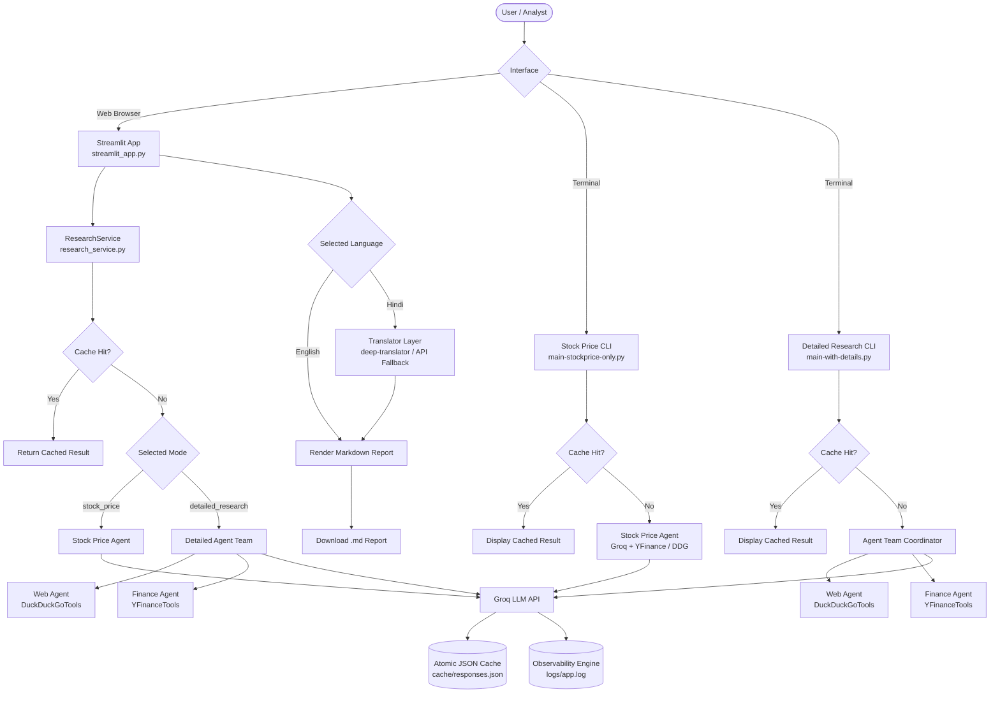
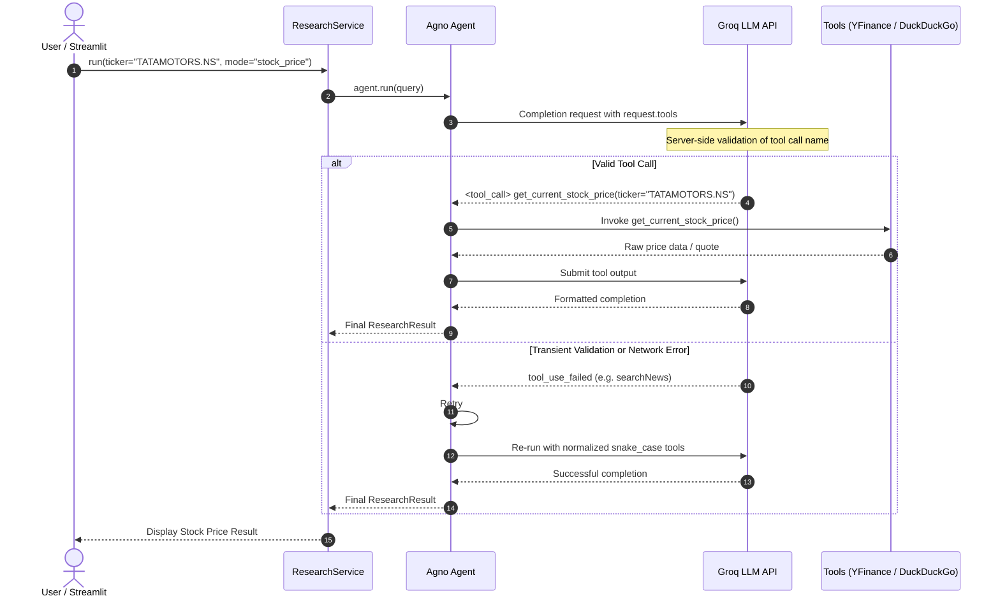
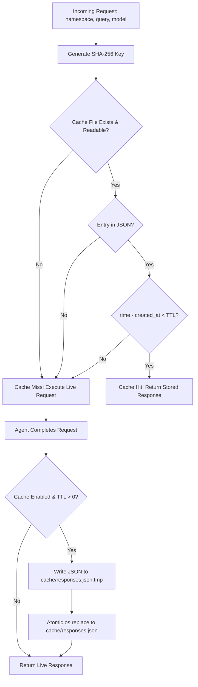

# Investment Research

An AI-powered equity research and financial market analysis platform built with **Agno**, **Groq**, **Yahoo Finance**, **DuckDuckGo**, and **Streamlit**.

The platform provides real-time stock quotes, comprehensive source-backed equity research reports, zero-LLM-cost multilingual translation (English / Hindi), atomic response caching, structured JSON observability, and quantitative technical analysis calculations.

---

## Table of Contents

- [Overview](#overview)
- [Functional Features](#functional-features)
  - [1. Real-Time Stock Price Lookup](#1-real-time-stock-price-lookup)
  - [2. Comprehensive Equity Research Reports](#2-comprehensive-equity-research-reports)
  - [3. Multilingual Translation (English / Hindi)](#3-multilingual-translation-english--hindi)
  - [4. Interactive Streamlit Web Dashboard](#4-interactive-streamlit-web-dashboard)
  - [5. Standalone Command-Line Tools](#5-standalone-command-line-tools)
  - [6. Quantitative Technical Indicators](#6-quantitative-technical-indicators)
- [System Architecture](#system-architecture)
  - [Architecture Flowchart](#architecture-flowchart)
  - [Directory Structure](#directory-structure)
  - [Technology Stack](#technology-stack)
- [Technical Details & Deep Dive](#technical-details--deep-dive)
  - [Tool Calling Architecture & Guardrails](#tool-calling-architecture--guardrails)
    - [Registered Tools & Function Signatures](#registered-tools--function-signatures)
    - [Multi-Agent Delegation Flow](#multi-agent-delegation-flow)
    - [Groq Server-Side Validation & Naming Normalization](#groq-server-side-validation--naming-normalization)
    - [Tool Call Budget & Runaway Protection](#tool-call-budget--runaway-protection)
    - [Anti-Blocking Session & Regional Ticker Support](#anti-blocking-session--regional-ticker-support)
    - [Automated Retry Mechanism](#automated-retry-mechanism)
  - [Cache Implementation & Storage Engine](#cache-implementation--storage-engine)
    - [Deterministic SHA-256 Keying Strategy](#deterministic-sha-256-keying-strategy)
    - [Atomic File Write Mechanism](#atomic-file-write-mechanism)
    - [TTL Expiration & Eviction Policy](#ttl-expiration--eviction-policy)
    - [Fail-Open Resilience & Error Recovery](#fail-open-resilience--error-recovery)
    - [Multi-Tiered Caching (Disk vs Session State)](#multi-tiered-caching-disk-vs-session-state)
  - [Translation Pipeline & Cost Optimization](#translation-pipeline--cost-optimization)
  - [Structured Observability & JSON-Lines Logging](#structured-observability--json-lines-logging)
- [Configuration Reference](#configuration-reference)
- [Installation & Setup](#installation--setup)
  - [Prerequisites](#prerequisites)
  - [Option A: Setup with `uv` (Recommended)](#option-a-setup-with-uv-recommended)
  - [Option B: Setup with standard `pip`](#option-b-setup-with-standard-pip)
  - [Environment Variables (.env)](#environment-variables-env)
  - [Streamlit Cloud Secrets](#streamlit-cloud-secrets)
- [Usage Guide](#usage-guide)
  - [Running the Streamlit Web Dashboard](#running-the-streamlit-web-dashboard)
  - [Running the Single-Query Stock Price CLI](#running-the-single-query-stock-price-cli)
  - [Running the Interactive Detailed Research CLI](#running-the-interactive-detailed-research-cli)
- [Testing & Quality Assurance](#testing--quality-assurance)
- [Disclaimer](#disclaimer)

---

## Overview

Investment Research bridges large language models and real-time financial market data to automate company research. It provides two core execution workflows:
1. **Stock Price Check**: A fast, low-token financial lookup providing the latest stock price, currency, and timestamp.
2. **Detailed Equity Research**: An autonomous multi-agent team that gathers live market fundamentals from Yahoo Finance and recent web news from DuckDuckGo, synthesizing them into a structured report with tables, risks, and source citations.

---

## Functional Features

### 1. Real-Time Stock Price Lookup
- Targeted prompt instructions restrict LLM responses strictly to price, currency, and last updated timestamp (no conversational filler).
- Token bounded with `STOCK_PRICE_MAX_TOKENS` (default: 200 tokens) for low latency and minimal inference cost.
- Resilient lookup: uses `YFinanceTools` as the primary market provider and automatically fails over to `DuckDuckGoTools` web search if financial API calls fail.

### 2. Comprehensive Equity Research Reports
- Multi-agent coordination: A lead coordinator orchestrates specialized web and financial agents.
- Generates structured equity reports covering:
  - **Executive Summary**: Core business activities and market position.
  - **Key Metrics**: P/E ratio, market cap, 52-week ranges, income statement highlights, and analyst recommendations.
  - **Market News & Catalysts**: Recent developments gathered from live web search.
  - **Risks & Uncertainties**: Operational, competitive, and macroeconomic headwinds.
  - **Source Citations**: Explicit links and attributions for all external data.

### 3. Multilingual Translation (English / Hindi)
- Instant translation of detailed equity research reports into **Hindi** (`hi`) directly within the Streamlit UI.
- **Zero Extra LLM Tokens**: Powered client-side by `deep-translator` (`GoogleTranslator`) rather than costly secondary LLM generation.
- **Session-State Caching**: Translations are cached in UI session state `(ticker, mode, "Hindi")` so toggling between English and Hindi is instantaneous.
- **Export in Target Language**: Downloaded Markdown reports reflect the currently selected language.

### 4. Interactive Streamlit Web Dashboard
- Modern web dashboard built with Streamlit (`streamlit_app.py`).
- Pre-populated with default tickers (e.g., `BHEL`, with quick examples like `HMA`, `RPOWER`, `JKTYRE`, `AAPL`).
- Dual action buttons: **Get stock price** and **Generate detailed research**.
- Live expandable progress status (`st.status`).
- One-click report download as Markdown (`<ticker>-<mode>-<language>.md`).
- Integrated sidebar displaying active Groq model, cache status, and workflow guide.

### 5. Standalone Command-Line Tools
- `main-stockprice-only.py`: Single-shot CLI for rapid price checks with ticker input validation and graceful exit on `Ctrl+C` or EOF.
- `main-with-details.py`: Interactive REPL research shell supporting consecutive company queries, cache lookups, and clean `exit` commands.

### 6. Quantitative Technical Indicators
- Module in `src/investment_research/analysis/technicals.py` providing pure-Python calculations:
  - **Simple Moving Average (`moving_average`)**: Computes sliding window averages over price series.
  - **Daily Returns (`daily_returns`)**: Calculates period-over-period percentage price changes.
  - **Maximum Drawdown (`maximum_drawdown`)**: Computes peak-to-trough drop over historical price sequences.

---

## System Architecture

### Architecture Flowchart



### Directory Structure

```text
Investment-Research/
├── .env.example                       # Template for environment variables
├── pyproject.toml                     # Project metadata, dependencies, and build configuration
├── requirements.txt                   # Standard pip dependency manifest
├── README.md                          # Complete functional and technical documentation
├── streamlit_app.py                   # Streamlit web dashboard entrypoint
├── main-stockprice-only.py            # Standalone CLI for stock price lookup
├── main-with-details.py               # Standalone interactive CLI for detailed research
├── logs/                              # Runtime log directory
│   └── app.log                        # Structured JSON-lines application logs
├── cache/                             # Local cache directory
│   └── responses.json                 # SHA-256 keyed JSON response cache
├── src/
│   └── investment_research/           # Core library package
│       ├── __init__.py                # Package initialization & CLI entry point
│       ├── settings.py                # Centralized immutable configuration (Settings)
│       ├── research_service.py        # High-level orchestration service (ResearchService)
│       ├── cache.py                   # Atomic JSON caching engine (ResponseCache)
│       ├── observability.py           # Structured JSON-lines logger & metric extractor
│       ├── translator.py              # Zero-LLM text chunking & Hindi translation pipeline
│       ├── analysis/
│       │   └── technicals.py          # Quantitative analysis (SMA, returns, drawdown)
│       ├── data/
│       │   └── market_data.py         # Ticker validation and normalization
│       └── reports/
│           └── report_format.py       # Markdown report structuring and required sections
└── tests/                             # Deterministic unit and integration test suite
    ├── test_cache.py                  # Cache hits, misses, TTL, and corruption recovery
    ├── test_market_data.py            # Ticker normalization and validation tests
    ├── test_report_format.py          # Report schema validation tests
    ├── test_research_service.py       # Agent tool call budget enforcement tests
    ├── test_settings.py               # Configuration defaults and immutability tests
    ├── test_streamlit_app.py          # Streamlit UI AppTest and translation state tests
    ├── test_technicals.py             # Math tests for SMA, returns, and drawdown
    └── test_translator.py            # Chunking and translation fallback tests
```

### Technology Stack

| Component | Technology | Version | Purpose |
| --- | --- | --- | --- |
| **Language** | Python | `>=3.13` | Modern Python runtime |
| **Package Management** | `uv` / `pip` | Latest | High-speed dependency resolver and virtual environment manager |
| **Agent Framework** | `agno` | `>=3.0.10` | Autonomous multi-agent coordination, tools, and instructions |
| **LLM Provider** | `groq` / `langchain-groq` | `<1.0.0` | Ultra-low latency inference for Llama / Qwen models |
| **Web UI** | `streamlit` | `>=1.57.0` | Interactive web dashboard and component rendering |
| **Financial Data** | `yfinance` | `>=1.7.0` | Market quotes, financials, analyst ratings, and news |
| **Live Web Search** | `ddgs` (DuckDuckGo) | `>=9.16.0` | Real-time web intelligence and source citations |
| **Translation Engine** | `deep-translator` | `>=1.11.4` | Client-side zero-token translation to Hindi |
| **Configuration** | `pydantic` & `python-dotenv` | `>=2.13.5` | Strict schema validation and `.env` loading |
| **Testing** | `pytest` | `>=8.0.0` | Deterministic unit and UI testing |

---

## Technical Details & Deep Dive

### Tool Calling Architecture & Guardrails

The application leverages Agno's agent framework integrated with Groq's low-latency inference engine, transforming Python tools into OpenAI-compatible tool schemas (`request.tools`) passed to the model endpoint.



#### Registered Tools & Function Signatures

1. **`YFinanceTools`**:
   - `get_current_stock_price(ticker: str) -> str`: Fetches live market quotes, currency, and update timestamps.
   - `get_company_news(ticker: str) -> str`: Retrieves recent corporate headlines and press releases.
   - `get_analyst_recommendations(ticker: str) -> str`: Obtains consensus ratings (Buy/Hold/Sell) and target prices.
   - `get_income_statements(ticker: str) -> str`: Pulls quarterly and annual financial balance sheets and revenue figures.
2. **`DuckDuckGoTools`**:
   - `web_search(query: str) -> str`: Conducts real-time web searches to retrieve market commentary, external perspectives, and source URLs.
   - `search_news(query: str) -> str`: Searches indexed news articles. *(Enabled in detailed research; disabled in stock price check to prevent model confusion).*
3. **`searchNews(query: str) -> str` (Safe Alias Tool)**:
   - Standalone Python function registered directly in `tools=[...]` of the stock price agent.
   - Directly maps to DuckDuckGo search. Acts as a safety net if a model emits camelCase `<function=searchNews>`, allowing Groq's server-side tool validator to accept the call rather than aborting the request.

#### Multi-Agent Delegation Flow

For comprehensive equity research (`main-with-details.py` and `_get_detailed_agent`), the platform implements a hierarchical multi-agent team:
- **`finance_agent`**: Bounded to Yahoo Finance tools; strictly instructed to extract structured financial data and format outputs using Markdown tables.
- **`web_agent`**: Bounded to DuckDuckGo tools; strictly instructed to gather recent market developments and always cite source URLs.
- **`agent_team` (Coordinator Agent)**: Orchestrates both specialist agents. It decomposes the user's research request, invokes `finance_agent` for quantitative financial figures, invokes `web_agent` for qualitative catalysts, and synthesizes both outputs into a unified report.

#### Groq Server-Side Validation & Naming Normalization

Groq validates generated tool calls against `request.tools` on the server:
- **The Issue**: Certain open-weights models (e.g. `qwen/qwen3.8-27b`) occasionally emit tool names in camelCase (e.g. `<function=searchNews>`) rather than the declared snake_case (`search_news` or `web_search`). If a function name does not exactly match `request.tools`, Groq throws an HTTP 400 `invalid_request_error: tool_use_failed`.
- **The Mitigation**:
  1. **Tool Decoupling**: In `_get_stock_price_agent`, news search is disabled (`enable_news=False`) so only `web_search` and `get_current_stock_price` are exposed.
  2. **Explicit Fallback Tool**: `searchNews` is explicitly registered in `tools=[...]` so Groq's validator recognizes it if emitted.
  3. **Prompt Hardening**: Instructions explicitly direct the model to use exact snake_case function names (`get_current_stock_price`, `web_search`) and teach the model how to map company names (e.g. `"Tata Motors"`) to exchange tickers (`TATAMOTORS.NS`).

#### Tool Call Budget & Runaway Protection

Every agent instance is bound by `tool_call_limit=settings.agent_tool_call_limit` (default: `5`):
- Prevents agents from entering recursive loops (e.g., repeatedly calling search tools without concluding).
- Halts execution once the budget is exhausted, preventing runaway inference billing and high latency.

#### Anti-Blocking Session & Regional Ticker Support

- **Custom Browser Emulation**: Yahoo Finance often blocks generic Python scraping scripts with HTTP 403 Forbidden. `research_service.py` attaches a custom `requests.Session` with desktop Chrome headers:
  ```python
  session.headers.update({
      "User-Agent": "Mozilla/5.0 (Windows NT 10.0; Win64; x64) AppleWebKit/537.36 (KHTML, like Gecko) Chrome/124.0.0.0 Safari/537.36",
      "Accept": "text/html,application/xhtml+xml,application/xml;q=0.9,*/*;q=0.8",
      "Accept-Language": "en-US,en;q=0.9",
  })
  ```
- **Regional Ticker Resolution**: For Indian equities (e.g., `BHEL`, `TATAMOTORS`, `RPOWER`, `JKTYRE`), instructions direct the agent to query with `.NS` (NSE) or `.BO` (BSE) suffixes if omitted by the user.
- **Failover Strategy**: If Yahoo Finance encounters rate limits or errors, the stock price agent automatically fails over to `web_search` to retrieve quotes.

#### Automated Retry Mechanism

- **Agent Retries**: Configured with `retries=2, delay_between_retries=1` on the Agno `Agent` to retry transient API blips.
- **Service Retry Loop**: `ResearchService.run` wraps tool execution in an automated retry handler. If a transient tool validation or network glitch occurs on attempt 1, it logs a `research_retry` event and re-executes immediately, ensuring a smooth user experience.

---

### Cache Implementation & Storage Engine

The caching subsystem in `src/investment_research/cache.py` (`ResponseCache`) provides an atomic, file-based JSON caching layer designed to eliminate redundant LLM inference costs and reduce response latencies.



#### Deterministic SHA-256 Keying Strategy

Each cache key is generated by taking the SHA-256 hexadecimal digest of a UTF-8 encoded composite key:

$$\text{Cache Key} = \text{SHA256}(\text{"namespace:model:query"})$$

- **`namespace`**: Isolates independent application workflows (e.g. `"stock_price"` vs. `"detailed_research"`).
- **`model`**: Isolates model IDs (e.g. `qwen/qwen3.8-27b` vs. `llama-3.3-70b-versatile`) so changing models never returns stale responses from a previous model architecture.
- **`query`**: The exact normalized query string (e.g. `"What is the current stock price of TATAMOTORS.NS?"`).

Example stored record in `cache/responses.json`:
```json
{
  "8f4b1d62c1a8e9e...": {
    "created_at": 1731478200.125,
    "response": "Current Stock Price: ₹980.50 INR (Last updated: 2026-11-13)"
  }
}
```

#### Atomic File Write Mechanism

Writing directly to a shared cache file with standard Python `open(..., "w")` truncates the file before writing, risking corruption (`JSONDecodeError`) if the process crashes, the disk fills, or concurrent threads read mid-write.

`ResponseCache.set()` solves this using atomic filesystem operations:
1. **Directory Guarantee**: Ensures `cache/` directory exists with `mkdir(parents=True, exist_ok=True)`.
2. **Temporary File Write**: Writes the updated JSON structure to a temporary file via `tempfile.NamedTemporaryFile` in the **same directory** (`cache/responses.json.<random>.tmp`).
3. **Atomic Replacement**: Calls `os.replace(temporary_path, self.path)`. On modern operating systems (Windows NTFS and POSIX filesystems), `os.replace` is an atomic filesystem syscall that re-points the directory inode/entry instantaneously.
4. **Guaranteed Cleanup**: A `finally` block ensures that any unlinked temporary files are cleanly removed if an unexpected exception occurs.

#### TTL Expiration & Eviction Policy

- **Time-to-Live**: Controlled by `CACHE_TTL_SECONDS` (default: `900` seconds / 15 minutes).
- **Validation**: When retrieving an entry:
  $$\Delta t = t_{\text{current}} - t_{\text{created}}$$
  If $\Delta t \ge \text{ttl\_seconds}$, the entry is discarded and treated as a cache miss.
- **Bypass Mode**: Setting `CACHE_TTL_SECONDS=0` or `CACHE_ENABLED=false` completely bypasses disk reads and writes.

#### Fail-Open Resilience & Error Recovery

The cache is designed to fail open so it never breaks the user application:
- All disk reads and writes catch `(OSError, ValueError, KeyError, TypeError)`.
- If `cache/responses.json` is missing, unreadable, locked, or corrupted with invalid JSON, `cache.get()` silently treats it as a cache miss (`None`).
- **Auto-Healing**: If a corrupted file exists, the next valid `cache.set()` call automatically replaces the corrupt file with a valid JSON payload.

#### Multi-Tiered Caching (Disk vs Session State)

The application implements a two-tier caching architecture:

| Cache Tier | Storage Location | Lifetime | Content Stored | Purpose |
| --- | --- | --- | --- | --- |
| **Disk Cache (`ResponseCache`)** | `cache/responses.json` | 15 min (Configurable via `CACHE_TTL_SECONDS`) | Raw LLM research responses | Persists across app reboots; skips LLM and finance API calls for identical queries. |
| **Session Cache (`st.session_state`)** | Browser / Streamlit Memory | Active Browser Session | Active `ResearchResult` and translated Hindi reports | Eliminates redundant translation calls when users toggle between English and Hindi. |

### Translation Pipeline & Cost Optimization
The translation layer in `src/investment_research/translator.py` translates reports into Hindi without incurring LLM inference costs:
- **Intelligent Chunking (`_split_into_chunks`)**: Translation APIs enforce input length limits (~5,000 characters). The module splits long markdown text at paragraph boundaries (`\n\n`), line breaks (`\n`), or words, with a safe chunk threshold of 3,500 characters.
- **Two-Tier Resilient Translation**:
  1. Primary: Uses `GoogleTranslator(source="auto", target="hi")`.
  2. Fallback: If `GoogleTranslator` encounters rate limits (`TooManyRequests`, `RequestError`), it automatically shifts to direct client HTTP requests (`https://translate.googleapis.com/translate_a/single`) with Android translate client headers.
- **English No-Op**: If the target language is `"English"` or `"en"`, the text returns immediately without network calls.

### Structured Observability & JSON-Lines Logging
Structured observability is built into every request via `src/investment_research/observability.py`:
- **Dual Outputs**: Logs are streamed in real time to standard console output and appended to `logs/app.log`.
- **JSON-Lines Format**: Every log line is formatted as a single valid JSON record using `JsonFormatter`:
  ```json
  {
    "timestamp": "2026-11-13T11:15:30+0530",
    "level": "INFO",
    "logger": "investment_research",
    "event": "research_completed",
    "application": "streamlit",
    "ticker": "BHEL",
    "mode": "detailed_research",
    "duration_ms": 2840.12,
    "response_metrics": {"input_tokens": 420, "output_tokens": 680}
  }
  ```
- **Tracked Lifecycle Events**:
  - `research_started`: Records ticker, query, model, and configured tools.
  - `research_completed`: Records latency (`duration_ms`) and token metrics.
  - `research_cache_hit`: Emitted when results are served from cache.
  - `research_failed`: Records duration, exception type, and full traceback.
  - `invalid_ticker`: Emitted when ticker validation fails.
  - `session_ended`: Emitted upon user exit or stream closure.

---

## Configuration Reference

Application settings are centralized in `src/investment_research/settings.py` as an immutable frozen dataclass (`Settings`) and can be configured through `.env` or system environment variables:

| Variable | Default Value | Description |
| --- | --- | --- |
| `GROQ_API_KEY` | *None* (Required) | Groq API authentication key. |
| `GROQ_MODEL` | `qwen/qwen3.8-27b` *(code)* / `llama-3.3-70b-versatile` *(.env.example)* | Groq model ID used for inference. |
| `STOCK_PRICE_MAX_TOKENS` | `200` | Token limit for single stock-price lookups. |
| `AGENT_TOOL_CALL_LIMIT` | `5` | Maximum allowed tool calls per agent run. |
| `DEFAULT_TICKER` | `BHEL` | Default ticker populated in the web dashboard. |
| `APP_NAME` | `Market Research` | Application brand name used in logs and UI title. |
| `LOG_LEVEL` | `INFO` | Logging verbosity (`DEBUG`, `INFO`, `WARNING`, `ERROR`). |
| `LOG_FILE` | `logs/app.log` | Destination path for structured JSON-lines log records. |
| `CACHE_ENABLED` | `false` | Set to `true`, `1`, `yes`, or `on` to enable response caching. |
| `CACHE_FILE` | `cache/responses.json` | Path to the local JSON response cache file. |
| `CACHE_TTL_SECONDS` | `900` | Lifetime of cached entries in seconds (900s = 15 minutes). Set to `0` to disable. |

> [!WARNING]
> Never commit your `.env` file or API keys to version control. Use `.env.example` as a safe template.

---

## Installation & Setup

### Prerequisites
- **Python**: Version `3.13` or later.
- **Groq API Key**: A valid API key obtained from [Groq Console](https://console.groq.com/).

### Option A: Setup with `uv` (Recommended)

`uv` is an extremely fast Python package and environment manager.

1. **Clone the repository and enter the directory**:
   ```bash
   git clone <repo-url>
   cd Investment-Research
   ```

2. **Sync the virtual environment and install dependencies**:
   ```powershell
   uv sync
   ```

3. **Create and configure your `.env` file**:
   ```powershell
   Copy-Item .env.example .env
   ```

4. **Add your Groq API key to `.env`**:
   ```dotenv
   GROQ_API_KEY=gsk_your_actual_groq_api_key_here
   ```

### Option B: Setup with standard `pip`

If you prefer standard Python tools:

1. **Create and activate a virtual environment**:
   ```powershell
   python -m venv .venv
   .venv\Scripts\Activate.ps1
   ```
   *(On macOS / Linux: `source .venv/bin/activate`)*

2. **Install dependencies**:
   ```powershell
   pip install -r requirements.txt
   ```

3. **Configure environment variables**:
   ```powershell
   Copy-Item .env.example .env
   # Edit .env and supply your GROQ_API_KEY
   ```

### Environment Variables (.env)

A typical `.env` setup:
```dotenv
GROQ_API_KEY=your-groq-api-key-here
GROQ_MODEL=llama-3.3-70b-versatile
STOCK_PRICE_MAX_TOKENS=200
AGENT_TOOL_CALL_LIMIT=5
DEFAULT_TICKER=BHEL
APP_NAME=Market Research
LOG_LEVEL=INFO
LOG_FILE=logs/app.log
CACHE_ENABLED=false
CACHE_FILE=cache/responses.json
CACHE_TTL_SECONDS=900
```

### Streamlit Cloud Secrets

When deploying to [Streamlit Community Cloud](https://share.streamlit.io), add your variables in **App Settings > Secrets**:
```toml
GROQ_API_KEY = "gsk_your_groq_api_key"
GROQ_MODEL = "llama-3.3-70b-versatile"
CACHE_ENABLED = "false"
```
`streamlit_app.py` automatically synchronizes all entries in `st.secrets` into `os.environ` upon startup.

---

## Usage Guide

### Running the Streamlit Web Dashboard

Launch the interactive web user interface:

```powershell
# Using uv:
uv run streamlit run streamlit_app.py

# Using standard virtualenv:
streamlit run streamlit_app.py
```

Open your browser at `http://localhost:8501`.

**Dashboard Features**:
- **Ticker Input**: Enter any stock symbol (e.g. `AAPL`, `TSLA`, `BHEL`, `RELIANCE`).
- **Get stock price**: Fetches real-time price, currency, and timestamp.
- **Generate detailed research**: Produces a full multi-agent equity analysis report.
- **Language Dropdown**: Switch between English and Hindi on demand.
- **Download**: Save the resulting analysis as a Markdown file.

### Running the Single-Query Stock Price CLI

To perform a fast price lookup directly from the command line:

```powershell
# Using uv:
uv run python main-stockprice-only.py

# Using standard virtualenv:
python main-stockprice-only.py
```

**Example interaction**:
```text
Enter ticker symbol (e.g., AAPL, TSLA): NVDA

Fetching price for NVDA...
Current Stock Price: $141.25 USD (Last updated: 2026-11-13)
```

### Running the Interactive Detailed Research CLI

To run the interactive research loop:

```powershell
# Using uv:
uv run python main-with-details.py

# Using standard virtualenv:
python main-with-details.py
```

**Example interaction**:
```text
Enter ticker symbol: TSLA
... (Agent team executes DuckDuckGo web search and Yahoo Finance data retrieval) ...
# Detailed Research Report on TSLA
...
Enter ticker symbol: exit
Goodbye.
```

---

## Testing & Quality Assurance

The project contains a comprehensive, deterministic test suite executed with `pytest`:

```powershell
# Using uv:
uv run pytest

# Using standard virtualenv:
pytest
```

To run offline/unit tests without network calls:
```powershell
uv run pytest tests/test_cache.py tests/test_market_data.py tests/test_report_format.py tests/test_settings.py tests/test_technicals.py tests/test_research_service.py
```

### Test Suite Coverage

- **`test_cache.py`**:
  - Cache set and get round-trip verification.
  - TTL expiration and stale entry invalidation.
  - Automatic recovery and overwrite of malformed or corrupted JSON cache files.
  - Disabling cache behavior when `ttl_seconds=0`.
  - Agno `response.content` extraction compatibility.
- **`test_market_data.py`**:
  - Ticker normalization: trimming leading/trailing whitespace and converting to uppercase.
  - Validation: rejecting empty or whitespace-only ticker inputs with `ValueError`.
- **`test_report_format.py`**:
  - Verification that formatted reports contain all required sections: Executive Summary, Key Metrics, Risks, and Sources.
- **`test_research_service.py`**:
  - Mocks agents and verifies that every specialist and coordinator agent strictly enforces the configured `agent_tool_call_limit`.
- **`test_settings.py`**:
  - Validates operational defaults for all configuration variables.
  - Asserts immutability of the frozen `Settings` dataclass.
- **`test_streamlit_app.py`**:
  - Uses Streamlit's `AppTest` harness to verify UI button rendering and form submission.
  - Verifies that toggling the language selectbox to Hindi populates the translation session cache without making extra LLM calls.
- **`test_technicals.py`**:
  - Simple Moving Average calculation and window boundary checks.
  - Daily returns percentage change calculation.
  - Peak-to-trough maximum drawdown calculation.
- **`test_translator.py`**:
  - English no-op bypass validation.
  - Handling of empty strings and whitespace.
  - Multi-paragraph chunk splitting under size limits.
  - Hindi translation and `ResearchService.translate_report` verification.

---

## Disclaimer

> [!IMPORTANT]
> The reports and financial data generated by this tool are for **informational and educational purposes only** and do **not** constitute financial, investment, or legal advice. Always conduct independent research and consult a licensed financial advisor before making investment decisions.
